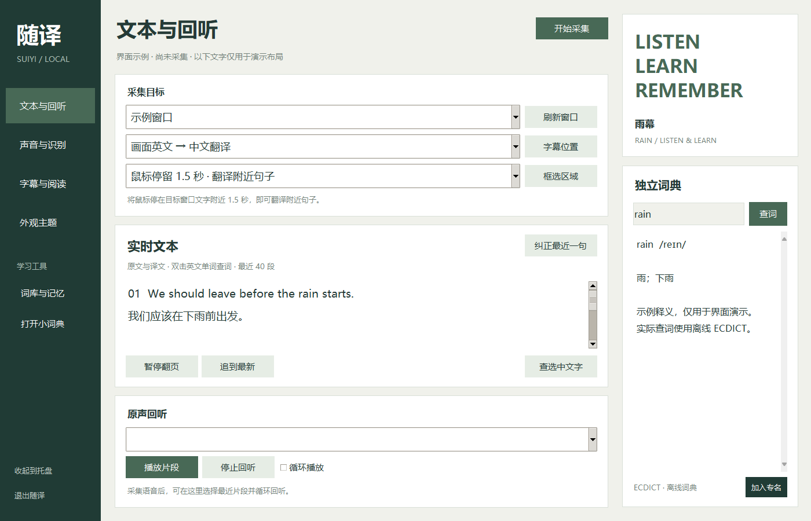

# 随译 Suiyi

Windows 本地字幕与听力学习工具。通过系统声音或选定画面区域生成字幕，将文本、查词和原声回听放在同一个学习工作台。

**源码公开，非商业使用免费 · 本地推理 · 无付费翻译接口 · 不修改游戏文件**

当前为 **v0.5 公开版**，提供中性主题源码及 Windows 完整离线安装包。普通用户选择 **`Suiyi-v0.5-Public-Setup.exe`**，包含基础模型、词库和运行环境，首次安装无需旧版或另装 Python；Turbo 仍为选装。仓库源码本身不包含模型、词库或 Python 环境，源码运行须按下文准备。发行材料与检查范围见[发行状态](docs/BINARY_RELEASE_STATUS.md)。

## 能做什么

- 英文声音输出英文原文字幕，或中英语音互译；识别所选输出设备的声音，不使用麦克风。
- 自动窗口、鼠标停留 1.5 秒取句、手动区域三种画面翻译方式；A「原文下方」与 B「独立字幕条」随时切换，支持调整字幕区域。
- 多段字幕、长句分页、暂停翻页、追到最新；工作台显示最近 40 段文本。
- 双击英文查词、独立词典区、词形还原；未知人名不编造释义。
- 最近语音片段回听、循环播放；音频缓存约 60 秒，退出后清除，不保存录音文件。
- 内置《重返未来：1999》名称提示；手动纠正后记录本地学习记忆。不是自动训练新模型的 Agent，不含完整官方剧情库。
- 雨幕和赤色两套静态配色，无角色插画。Turbo 大模型为选装；完整安装器内置 NVIDIA GPU 运行支持。

## 界面



预览使用合成示例文字，不是游戏官方剧情或真实识别准确率展示。另一套配色见[赤色主题](docs/images/workspace-scarlet.png)。

## 安装后使用

从本项目 Releases 下载 `Suiyi-v0.5-Public-Setup.exe`，阅读许可并安装，再从开始菜单打开随译。先选择声音或画面模式、目标窗口及字幕位置，再点击开始采集。安装不会自动采集音频。GPU 库内置，兼容 NVIDIA 显卡可用于加速；也可在设置中选「仅CPU」。

完整安装包与旧私人版 `Core-Setup.exe`、旧版 `Update.exe` 是不同产物，请按 `Public-Setup.exe` 文件名选择。该程序尚未购买代码签名证书，首次运行可能被 Windows 标记为未知发布者；请核对发行页 SHA-256 和来源，遇到实际恶意软件检测时停止并报告，不要关闭系统防护。

## 从源码运行

需要 **Windows 10/11 x64、Python 3.12 x64**（含 Tcl/Tk），以及可用的系统音频输出设备。当前不支持 macOS/Linux 桌面。以下命令在仓库目录的 PowerShell 执行：

```powershell
py -3.12 -m venv .venv
.\.venv\Scripts\python.exe -m pip install -r requirements.txt
.\.venv\Scripts\python.exe download_models.py
.\.venv\Scripts\python.exe tools/prepare_dictionary.py
.\.venv\Scripts\python.exe tools/prepare_ocr.py
.\.venv\Scripts\python.exe app.py
```

首次依赖和资源准备需要联网、占用磁盘，并受上游下载可用性影响；日常识别、翻译和查词在本机执行，没有在线兜底或付费 API。只有界面预览时可以不准备模型/词库。

可选 NVIDIA GPU（需兼容驱动和硬件，另占磁盘/显存）：

```powershell
.\.venv\Scripts\python.exe -m pip install -r requirements-gpu.txt
```

可选 Turbo（额外约 1.62 GB 模型文件，下载量另计）：

```powershell
.\.venv\Scripts\python.exe download_models.py --with-turbo
```

资源按锁文件校验，损坏或上游变更会明确失败，不会静默换成另一版模型。安装成功后保留 `models/` 和 `dictionary/ecdict.sqlite3`；`.cache/` 内的下载归档可在程序关闭时清理。更多见[开发与构建](docs/DEVELOPMENT.md)。

## 适用范围与限制

适合游戏、视频和网页的中英听读学习。口音、背景音乐、多人重叠、快速对白仍可能造成错误；离线小模型不能保证官方台词级准确率，也不具备通用大模型的篇章理解。翻译按句进行，不能保证谚语总是自然。

语音来自所选输出设备的混音，**目前不是单个应用隔离录音**。独占全屏、受保护内容和部分窗口可能无法正确捕获/叠加。画面自动模式和悬停模式无需框选；译文下方没有安全空位时保留在工作台，也可设置独立字幕条。不能保证任意画面都自动避开所有重要内容。

源码包小不代表安装后只占同样空间。模型与 GPU 库是主要磁盘占用；识别仍消耗 CPU/GPU/内存，不承诺零负载、固定延迟或所有电脑上的同一准确率。

## 文档与参与

- [使用指南](docs/USER_GUIDE.md) · [本地数据与隐私](docs/PRIVACY.md)
- [开发、测试与构建](docs/DEVELOPMENT.md) · [发布步骤](docs/RELEASING.md)
- [第三方说明](docs/THIRD_PARTY.md) · [当前二进制发布状态](docs/BINARY_RELEASE_STATUS.md)
- [贡献说明](CONTRIBUTING.md) · [更新记录](CHANGELOG.md)

## 许可

项目可授权部分采用 **[PolyForm Noncommercial 1.0.0](LICENSE)**。允许许可规定的非商业学习、使用、修改和分享，**没有授予第三方商业使用许可**。须保留许可证及 [NOTICE](NOTICE.md)。第三方组件与数据继续按各自许可使用。

这属于 source-available（源码可见），不是 OSI 定义的开源。不能宣传为 MIT、允许任意商业使用，或把第三方组件改成非商业许可。详见[中文授权说明](docs/LICENSE_ZH.md)。

本项目与所涉及游戏、模型或词典上游无官方隶属或背书关系。
